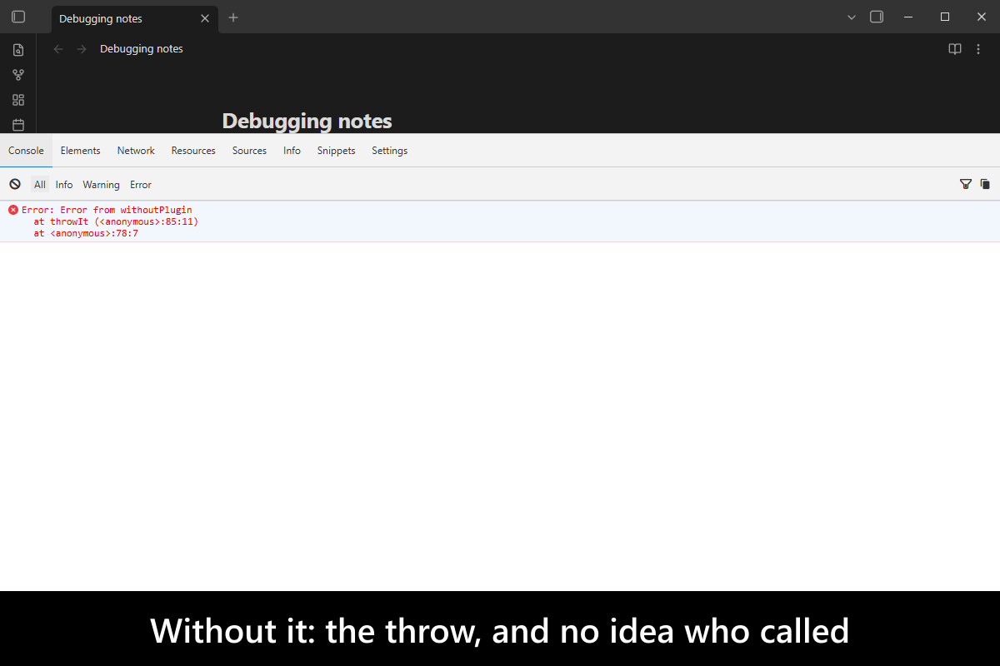
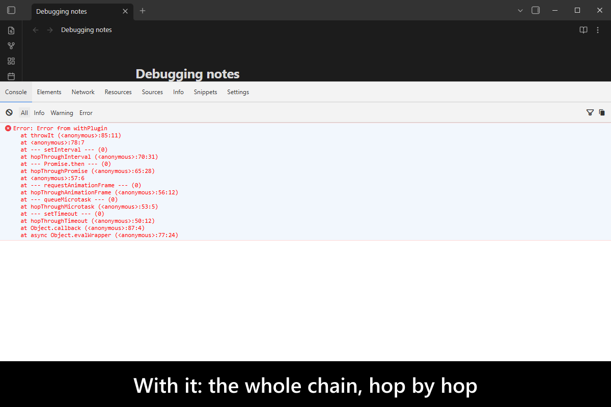
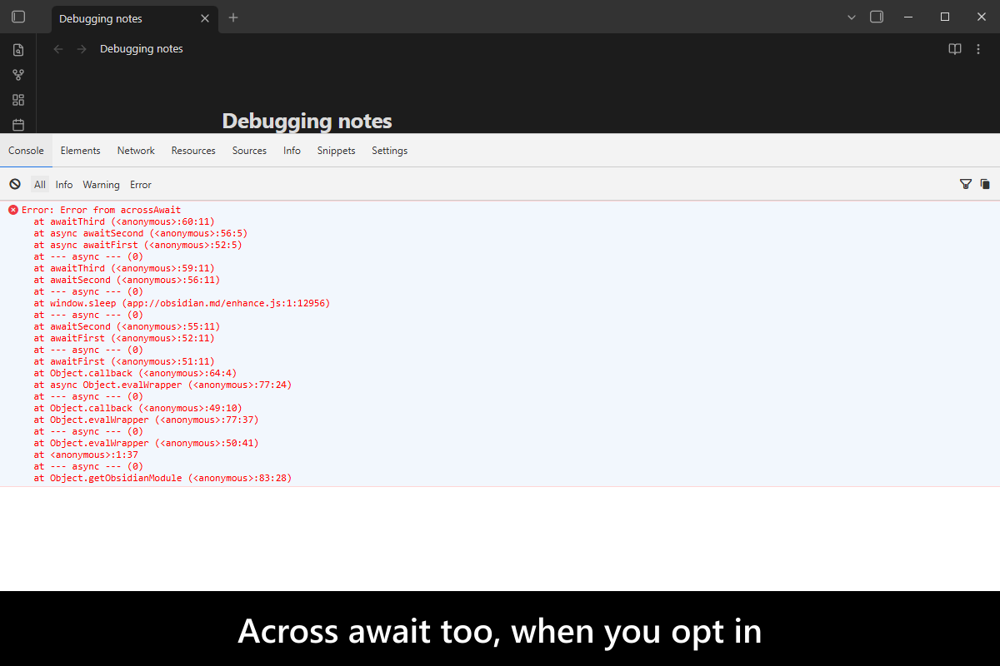
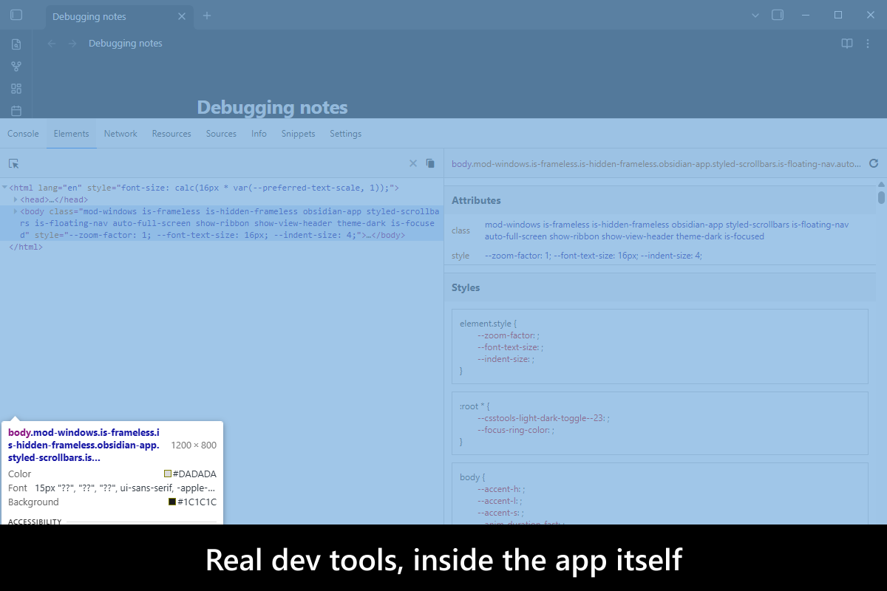
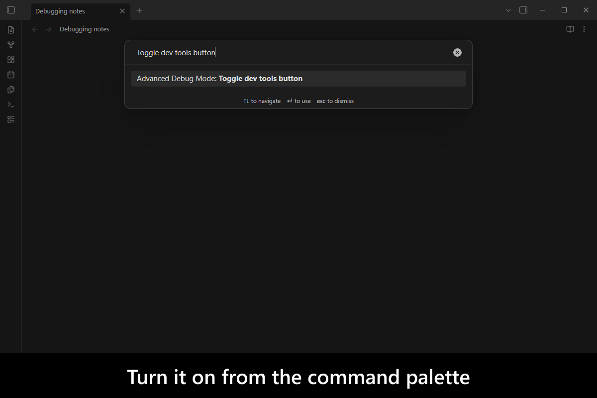
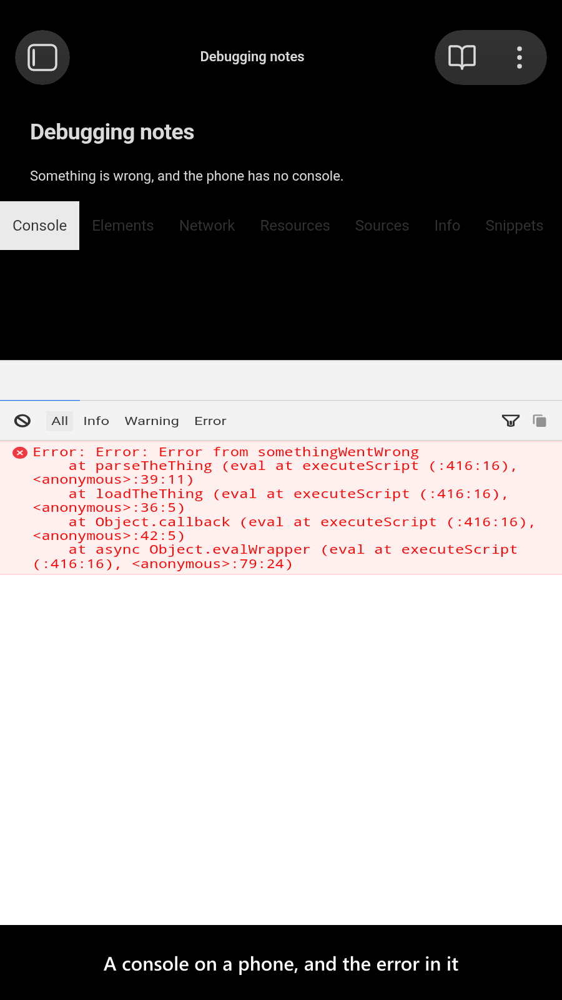
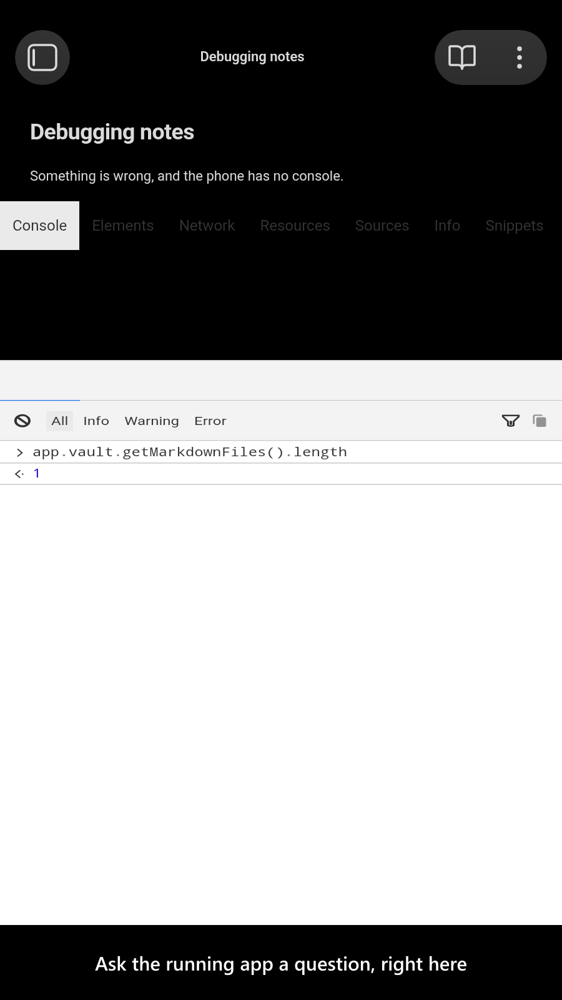
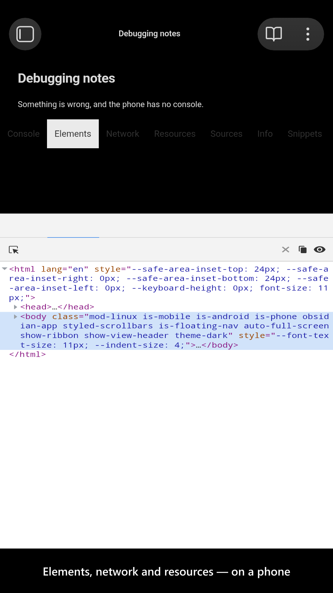
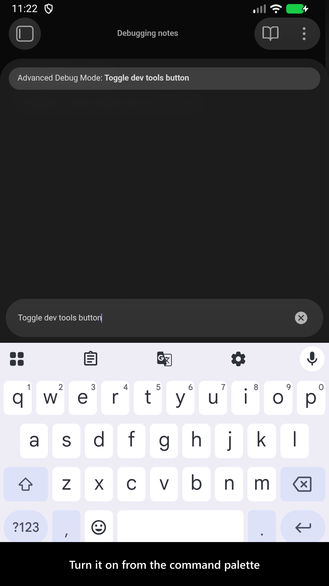

# Advanced Debug Mode

[](https://www.buymeacoffee.com/mnaoumov) [](https://github.com/mnaoumov/obsidian-advanced-debug-mode/releases) [](https://github.com/mnaoumov/obsidian-advanced-debug-mode/releases) [](https://github.com/mnaoumov/obsidian-advanced-debug-mode)

An error thrown inside a callback or an `await` arrives in the console with most of its stack already gone: you get the frame that threw and almost nothing about who called it. Debugging a plugin in [Obsidian](https://obsidian.md/) then means guessing, or littering the code with logging until the path becomes obvious.

This plugin restores those frames. It keeps long stack traces across callback and `async` boundaries, turns off the timeouts that fire while you sit on a breakpoint, brings DevTools to the mobile app, and gives the `debug` namespaces a UI instead of hand-edited `localStorage`.

<!-- markdownlint-disable MD033 -->

<a href="https://github.com/mnaoumov/obsidian-advanced-debug-mode/blob/HEAD/images/screenshots/screenshot-desktop-1.png"></a>

<details>
<summary>More screenshots</summary>

<div>
<a href="https://github.com/mnaoumov/obsidian-advanced-debug-mode/blob/HEAD/images/screenshots/screenshot-desktop-2.png"></a>
<a href="https://github.com/mnaoumov/obsidian-advanced-debug-mode/blob/HEAD/images/screenshots/screenshot-desktop-3.png"></a>
<a href="https://github.com/mnaoumov/obsidian-advanced-debug-mode/blob/HEAD/images/screenshots/screenshot-desktop-4.png"></a>
<a href="https://github.com/mnaoumov/obsidian-advanced-debug-mode/blob/HEAD/images/screenshots/screenshot-desktop-5.png"></a>
<a href="https://github.com/mnaoumov/obsidian-advanced-debug-mode/blob/HEAD/images/screenshots/screenshot-mobile-1.png"></a>
<a href="https://github.com/mnaoumov/obsidian-advanced-debug-mode/blob/HEAD/images/screenshots/screenshot-mobile-2.png"></a>
<a href="https://github.com/mnaoumov/obsidian-advanced-debug-mode/blob/HEAD/images/screenshots/screenshot-mobile-3.png"></a>
<a href="https://github.com/mnaoumov/obsidian-advanced-debug-mode/blob/HEAD/images/screenshots/screenshot-mobile-4.png"></a>
</div>

</details>

<!-- markdownlint-enable MD033 -->

## Demo vault

**The documentation is a demo vault.** Every feature has a note that explains what it does and why you would want it, with buttons that throw real errors so you can watch the traces yourself.

**[Start reading here](<./demo-vault/00 Start.md>)** — it is plain markdown, so it works on GitHub with nothing installed.

A copy of the vault ships with every release. You can access it via any of the following:

1. Running the **`Advanced Debug Mode`: Open demo vault** command.
2. Downloading `advanced-debug-mode-demo-vault.zip` from the [Releases](https://github.com/mnaoumov/obsidian-advanced-debug-mode/releases). It unzips into a single `advanced-debug-mode-demo-vault-<version>` folder.
3. Browsing its source in [`demo-vault/`](./demo-vault/README.md) in this repository.

## What it does

- **Obsidian's own debug mode**, toggled from a command instead of the console. [01 Debug mode](<./demo-vault/01 Debug mode.md>)
- **Long stack traces** — the frames behind a callback boundary, kept rather than discarded. [02 Long stack traces](<./demo-vault/02 Long stack traces.md>)
- **Async long stack traces** — the same across `await`, opt-in because it is desktop-only. [03 Async long stack traces](<./demo-vault/03 Async long stack traces.md>)
- **Timeouts that do not fire while you are on a breakpoint**, so a slow debugging session does not trip Obsidian's own long-running-task limits. [04 Long running tasks](<./demo-vault/04 Long running tasks.md>)
- **Every debug switch in one place** — the app-wide switches that libraries and plugins built on `@mnaoumov/typescript-lib` register, such as keeping a timed out `runWithTimeout` operation running, listed as toggles and saved across reloads, with a notice naming any switch left away from its default. [04 Long running tasks](<./demo-vault/04 Long running tasks.md>)
- **DevTools on mobile**, where the app has none, plus a UI for the `debug` library's namespaces. [05 More debug tools](<./demo-vault/05 More debug tools.md>)
- **Any plugin's debug messages in one step** — a view listing every installed plugin with a checkbox, a filter and all on / all off, so you can change several at once; a command that flips the one you pick; and a toggle per plugin in settings — instead of the `window.DEBUG.enable('<plugin-id>')` line a README asks you to type. [05 More debug tools](<./demo-vault/05 More debug tools.md>)
- **Console messages that keep their real source** — DevTools links each message to the code that logged it, not to this plugin's wrappers. [05 More debug tools](<./demo-vault/05 More debug tools.md>)
- **A panic button for a runaway operation** — the app-wide shared abort, as a hotkey-bindable command and a settings button instead of a line typed into the console. [05 More debug tools](<./demo-vault/05 More debug tools.md>)
- **Every setting**, by the key it is stored under. [06 Settings](<./demo-vault/06 Settings.md>)
- **Slow plugin loading on purpose** — delays before or after each other plugin's `onload`, the metadata cache's first resolve and the layout load, so you can test how a plugin behaves when its neighbors load slowly. [07 Plugin load delays](<./demo-vault/07 Plugin load delays.md>)

## See also

[My other Obsidian resources](https://github.com/mnaoumov/obsidian-resources)

| Plugin | Features | How `Advanced Debug Mode` differs |
| --- | --- | --- |
| [`Logcollector`](https://community.obsidian.md/plugins/logcollector) | `Logstravaganza` fork; external log files; UTC/local timestamps; plain text | Complementary console tooling; changes console output; no log file |
| [`Logstravaganza`](https://community.obsidian.md/plugins/logstravaganza) | Console calls and uncaught exceptions saved to a vault note | Complementary console tooling; changes console output; no log file |
| [`vConsole`](https://community.obsidian.md/plugins/vconsole) | In-page console; network, DOM and storage tools; JavaScript prompt | Alternative mobile DevTools through `eruda`; long stacks, debug namespaces, switches and task timeouts |

Last searched for similar plugins on 2026-10-26.

## Installation

The plugin is available in [the official Community Plugins repository](https://community.obsidian.md/plugins/advanced-debug-mode).

### Beta versions

To install the latest beta release of this plugin (regardless if it is available in [the official Community Plugins repository](https://community.obsidian.md) or not), follow these steps:

1. Ensure you have the [BRAT plugin](https://community.obsidian.md/plugins/obsidian42-brat) installed and enabled.
2. Click [Install via BRAT](https://intradeus.github.io/http-protocol-redirector?r=obsidian://brat?plugin=https://github.com/mnaoumov/obsidian-advanced-debug-mode).
3. An Obsidian pop-up window should appear. In the window, click the `Add plugin` button once and wait a few seconds for the plugin to install.

## Debugging

Every other plugin documents a console command here. This one does not need to: **turning debug messages on and off is what it does**. Run **`Advanced Debug Mode`: Open plugin debug messages** (or click the bug icon in the ribbon) and tick `Advanced Debug Mode` — or any other installed plugins, as many as you like. For a single plugin, **`Advanced Debug Mode`: Toggle debug messages for a plugin...** flips the one you pick, and the **Plugin debug messages** group of `Settings -> Community plugins -> Advanced Debug Mode` has a toggle per plugin. None of them touches the console or `localStorage`. See [05 More debug tools](<./demo-vault/05 More debug tools.md>).

The console form still works, and is the one to use if this plugin is not loaded yet, which is exactly when you would need it:

```js
window.DEBUG.enable('advanced-debug-mode');
```

For more details, refer to the [documentation](https://mnaoumov.dev/obsidian-lib/guides/debugging/).

## Changelog

All notable changes to this project will be documented in the [CHANGELOG](./CHANGELOG.md).

## Contributing

Contributions are welcome — see [CONTRIBUTING](./CONTRIBUTING.md) to get set up.

## Support

<!-- markdownlint-disable MD033 -->

<a href="https://www.buymeacoffee.com/mnaoumov" target="_blank"></a>

<!-- markdownlint-enable MD033 -->

### Filing an issue (for AI agents and humans)

Open issues through the [issue forms](https://github.com/mnaoumov/obsidian-advanced-debug-mode/issues/new/choose), not as blank issues.

To report a bug from inside Obsidian, run the **`Advanced Debug Mode`: Report a bug** command. It opens the bug form with the plugin version, the Obsidian version and your operating system already filled in.

Filing from the CLI or the API (`gh issue create --body`, or an AI agent filing for you) skips the form, and `gh issue create --template` cannot load an issue form. In that case, open the matching form in [`.github/ISSUE_TEMPLATE/`](https://github.com/mnaoumov/obsidian-advanced-debug-mode/tree/HEAD/.github/ISSUE_TEMPLATE), copy every field as a `### <label>` heading in the form's order, and fill in each one. Always state the plugin version, the Obsidian version and your operating system.

## License

© [Michael Naumov](https://github.com/mnaoumov/)
